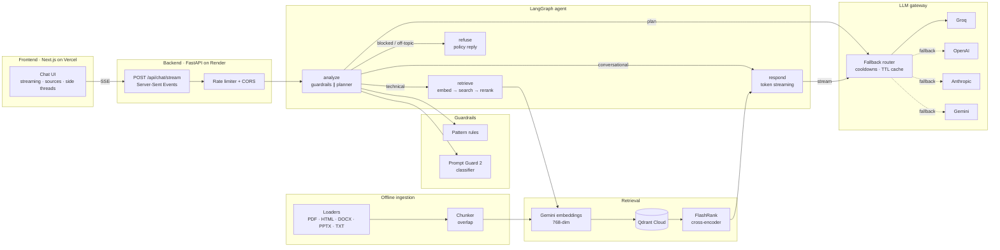

# StratumAI Architecture

## Request lifecycle

1. The browser posts the message, recent history and model preference to `/api/chat/stream` and reads the Server-Sent Events stream.
2. `analyze` runs the input guardrails and the planner concurrently. The planner uses the gateway's fast model to classify intent and rewrite follow-ups into standalone search queries.
3. Technical questions go to `retrieve`: the query is embedded with Gemini, the top candidates are pulled from Qdrant and reranked locally with FlashRank. Sources are streamed to the client immediately.
4. `respond` streams the answer token by token through the gateway. The gateway walks the configured provider order and falls back on errors, rate limits or slow first tokens, putting failing providers into cooldown.
5. A final `done` event carries the plan, the provider and model that answered, latency and time to first token.

## Design choices

| Concern | Choice | Reason |
| --- | --- | --- |
| Latency | Guardrails and planner in parallel, pooled HTTP keep-alive, first-token timeout | Users see tokens in well under a second on Groq |
| Memory footprint | Provider calls over `httpx` instead of heavy SDKs | Starts in seconds and stays well inside Render's free 512 MB |
| Resilience | Ordered fallback across four providers with per-provider cooldowns | One expired key or rate limit never takes the app down |
| Statelessness | Client sends the recent history with each request | Survives restarts and free-tier sleep, scales horizontally |
| Grounding | Rerank before generation, numbered citations, source snippets in the UI | Answers can be verified against the knowledge base |
