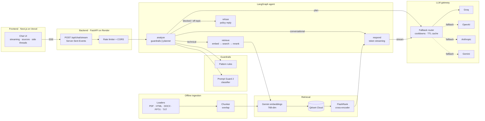

<div align="center">

# StratumAI

**An agentic RAG assistant that answers engineering questions from your team's own documentation, with sources, in real time.**

[](https://frontend-fawn-one-34.vercel.app/)
[](https://stratumai-api.onrender.com/docs)


**[Try it live](https://frontend-fawn-one-34.vercel.app/)** · **[API docs](https://stratumai-api.onrender.com/docs)** · **[Architecture](ARCHITECTURE.md)** · **[Deployment guide](DEPLOYMENT.md)**

</div>

> [!NOTE]
> The backend runs on Render's free tier and sleeps when idle. The first request can take up to a minute while it wakes. The UI shows a "waking up" banner and keeps your message until the API is ready.

---

## The problem

Engineering knowledge is spread across runbooks, wiki pages, slide decks and Word documents. When an engineer needs to know how to autoscale a pod or debug a failing CronJob, they either search five tools or ask a colleague.

General-purpose chatbots don't solve this:

- **They hallucinate.** They answer confidently from training data, not from *your* docs, and give no way to check the answer.
- **They are fragile.** One provider outage, expired key or rate limit and the assistant stops working.
- **They are easy to manipulate.** Prompt injection ("ignore previous instructions…") can hijack an assistant that has no guardrails.
- **They feel slow.** Waiting 10 seconds for a full answer to show up hurts adoption.

## The solution

StratumAI is a production-style **retrieval-augmented generation (RAG)** system built around four goals:

| Goal | How StratumAI does it |
| --- | --- |
| **Grounded** | Every technical answer is generated from passages retrieved from the knowledge base and reranked with a cross-encoder. Answers carry numbered citations, and the source snippets are shown in the UI. |
| **Resilient** | A custom LLM gateway routes across **Groq, OpenAI, Anthropic and Gemini** with ordered fallback, per-model cooldowns and response caching, so one failing provider never takes the app down. |
| **Safe** | Layered input guardrails (size limits, pattern rules, Meta's **Prompt Guard 2** classifier, topical routing) block injection attempts before any model sees them. |
| **Fast** | Guardrails and query planning run **in parallel**. Answers stream token by token over **Server-Sent Events**, and slow providers are skipped if the first token doesn't arrive in time. |

### What it looks like to use

- Streaming chat with Markdown, syntax-highlighted code and clickable citations
- A **sources panel** showing the exact passages each answer used
- **Side threads**: select any text in an answer and ask a follow-up in a side panel without derailing the main conversation
- Model picker, light/dark theme, **voice input** and **read-aloud**
- Conversation history kept in the browser, so the API stays stateless

---

## Architecture



### How a request flows

1. **Send.** The browser posts the message, recent history and model preference to `/api/chat/stream` and starts reading the SSE stream.
2. **Analyze.** Two tasks run concurrently with `asyncio.gather`:
   - **Guardrails** check the raw input for size, injection patterns and a Prompt Guard 2 score.
   - **Planner** asks a fast model to label the intent (`technical`, `conversational`, `off_topic`) and rewrite follow-ups into standalone search queries, so "how do I scale it?" still finds the right documents.
3. **Route.** The LangGraph agent picks one path: **retrieve** for technical questions, **respond** directly for small talk, **refuse** for blocked or off-topic input (no model call at all).
4. **Retrieve.** The query is embedded with Gemini, the top 12 candidates come back from Qdrant and **FlashRank** reranks them locally down to the best 5 within a context budget. Sources are streamed to the browser *before* generation starts.
5. **Respond.** The answer streams token by token through the gateway. If a provider errors, rate-limits or is slow to send its first token, the gateway moves to the next one.
6. **Done.** A final event reports the plan, which provider and model answered, the number of fallbacks, total latency and time to first token.

### Two-stage retrieval

| Stage | Component | Why |
| --- | --- | --- |
| 1. Recall | Gemini `gemini-embedding-001` (768-dim) + Qdrant cosine search | Fast and cheap over the whole collection |
| 2. Precision | FlashRank `ms-marco-MiniLM-L-6-v2` cross-encoder (ONNX, CPU) | Scores query and passage *together*, catching nuance that vector similarity misses. Reranks in under 100 ms with no GPU and no paid API |

If reranking fails, the system falls back to the vector scores. If retrieval fails entirely, it still answers and says it had no context.

### Ingestion pipeline

An offline CLI turns raw files into searchable vectors:

**Discover → Parse → Chunk → Cache → Embed → Upsert**

- Format-specific loaders: `pypdf` with a `pdfplumber` fallback for pages with no text, BeautifulSoup for HTML (keeps headings, tables and code, drops navigation), `python-docx`, `python-pptx` (including speaker notes)
- ~1,200-character chunks on paragraph boundaries with 200-character overlap
- Deterministic point IDs (`uuid5(file:chunk)`), so re-running ingestion is **idempotent**
- Batched embedding with exponential backoff on rate limits

The repository also includes a **noisy distractor set** of 58 unrelated technical PDFs (networking, compilers, CPU paging…) next to the real Kubernetes and Databricks docs, used to test whether retrieval still finds the right passages when the corpus is full of irrelevant material.

---

## Engineering decisions

These are the trade-offs that shaped the system.

| Concern | Decision | Result |
| --- | --- | --- |
| **Latency** | Guardrails and planner run in parallel. Pooled HTTP keep-alive. First-token timeout on each provider. | Tokens start appearing in well under a second on Groq. Guardrails add no latency to allowed requests. |
| **Memory footprint** | Provider calls, embeddings and Qdrant search go over one shared `httpx.AsyncClient` instead of the official SDKs. Heavy parsers are only installed for ingestion. | The SDKs roughly tripled startup time and memory. Without them the API starts in seconds and fits in Render's free **512 MB**. |
| **Resilience** | Every provider/model pair is its own target with its own cooldown. Invalid keys cool down for 10 min, rate limits for the provider's `retry-after`, transient errors for 15 s. Cooling targets are tried last, not skipped. | Free-tier quotas are per model, so a rate-limited Groq model hands over to the next Groq model before leaving the provider. The app still answers when every provider is degraded. |
| **Stream integrity** | Fallback only happens before the first token. A stream that fails mid-answer ends with an error event. | Users never see two different models' answers stitched together. |
| **Cost** | In-memory LRU cache with TTL for identical requests. The planner uses a dedicated small model. | Planning and answering never compete for the same quota, and repeat questions cost nothing. |
| **Statelessness** | The client sends recent history with each request. No server sessions. | Survives restarts and free-tier sleep, and scales horizontally. |
| **Safety without false blocks** | The classifier has a 2 s timeout and fails open. Threshold is configurable. | A guardrail outage never locks out legitimate users. |
| **Streaming through proxies** | `Cache-Control: no-transform`, `X-Accel-Buffering: no`, no compression middleware. | Tokens aren't buffered by Render's or Vercel's edge. |

## Challenges solved

- **Free-tier cold starts.** Render sleeps idle instances. The frontend pings `/health` on load, shows a wake-up banner and retries, so the user's first message is never lost. The reranker model warms up in a background thread at startup.
- **Follow-up questions breaking retrieval.** "What about its limits?" means nothing to a vector database. The planner rewrites each turn into a standalone query using the conversation history.
- **Per-model rate limits.** Treating a provider as one unit wasted quota. Splitting routing into provider/model targets with separate cooldowns kept free-tier keys usable under load.
- **Reasoning-model latency.** `gpt-oss` models on Groq are called with `reasoning_effort: low`, which cut time to first token noticeably with little quality loss for this domain.
- **Embedding/collection mismatch.** Changing the embedding model silently breaks search. The collection is created from `EMBEDDING_DIM` and the ingestion CLI's `--recreate` flag handles full re-indexing.

---

## Tech stack

| Layer | Technology |
| --- | --- |
| Frontend | Next.js 16, React 19, TypeScript, Tailwind CSS 4, react-markdown, Vitest |
| API | FastAPI, Pydantic v2, Server-Sent Events, custom rate limiter |
| Agent | LangGraph `StateGraph` (analyze → retrieve → respond / refuse) |
| LLMs | Groq (`gpt-oss-120b`, `gpt-oss-20b`), OpenAI (`gpt-4.1-mini`), Anthropic (`claude-haiku-4-5`), Gemini (`gemini-flash-lite`) |
| Retrieval | Gemini embeddings, Qdrant Cloud, FlashRank cross-encoder |
| Guardrails | Regex policies, Meta Prompt Guard 2 (86M) |
| Observability | Logfire spans for requests, fallbacks and time to first token (optional) |
| Evaluation | RAGAS-style metrics (faithfulness, answer relevancy, context precision/recall) over a hand-written golden dataset |
| Infra | Docker, Docker Compose, GitHub Actions, Render (API), Vercel (web) |

## Quality and evaluation

- **84 automated tests**: 64 backend (API, gateway fallback and cooldowns, providers, guardrails, planner) that run offline with stubbed providers, plus 20 frontend tests (API client, streaming hook, helpers).
- **Live tests** (`pytest -m live`) against real providers, Qdrant and embeddings.
- **Connection checker** that reports every configured model, the fallback chain, guardrails and retrieval in one run.
- **Load test** script that simulates concurrent users against a running server.
- **Golden dataset** of 15 question/answer pairs written from the source documents, plus guardrail test cases, used to score faithfulness, relevancy and context quality. See [backend/DOCS/11_EVALS_PIPELINE.md](backend/DOCS/11_EVALS_PIPELINE.md).
- **CI**: GitHub Actions builds both Docker images on every push and pull request.

---

## Repository layout

```
StratumAI/
├── backend/            FastAPI service (deployed to Render)
│   ├── app/
│   │   ├── agents/     LangGraph graph, nodes and prompts
│   │   ├── api/        routes, SSE streaming, schemas, rate limiting
│   │   ├── gateway/    multi-provider LLM router with fallback
│   │   ├── guardrails/ input policies and injection classifier
│   │   ├── ingestion/  document loaders, chunking and indexing CLI
│   │   └── services/   embeddings, vector search, reranking
│   ├── DATA/           source documents (true + noisy distractors)
│   ├── DOCS/           design notes for every subsystem
│   ├── evals/          golden dataset
│   ├── scripts/        connection checker, load test
│   └── tests/          unit, API and live tests
├── frontend/           Next.js app (deployed to Vercel)
├── docker-compose.yml  API + web stack for local Docker runs
└── render.yaml         Render blueprint
```

## Running locally

### With Docker (quickest)

```bash
cp .env.example .env      # fill in at least one LLM provider key
docker compose up --build
```

- Web app: http://localhost:3000
- API: http://localhost:8000, interactive docs at http://localhost:8000/docs

Index the knowledge base from inside the container:

```bash
docker compose exec api python -m app.ingestion.processor DATA/true_data --recreate
```

<details>
<summary><b>Without Docker</b></summary>

Requirements: Python 3.12+, Node.js 20+.

1. Copy `.env.example` to `.env` in the repository root and fill in the keys.
2. Start the API:

   ```bash
   cd backend
   python -m venv .venv
   .venv/Scripts/activate        # macOS/Linux: source .venv/bin/activate
   pip install -r requirements-ingest.txt
   uvicorn app.main:app --reload --port 8000
   ```

3. Index the knowledge base (first run, or after adding documents):

   ```bash
   python -m app.ingestion.processor DATA/true_data --recreate
   ```

4. Start the web app:

   ```bash
   cd frontend
   cp .env.example .env.local
   npm install
   npm run dev
   ```

</details>

<details>
<summary><b>Docker notes</b></summary>

- `backend/Dockerfile`: Python 3.12 slim, non-root user, `HEALTHCHECK` on `/health`. `frontend/Dockerfile`: Next.js standalone output on Node 22 alpine. The web container waits for the API to report healthy.
- The FlashRank model downloads on first use into the `flashrank-cache` volume, so it survives rebuilds.
- `NEXT_PUBLIC_API_URL` is compiled into the browser bundle at build time and defaults to `http://localhost:8000`.

</details>

## Testing

```bash
# backend
cd backend
pip install -r requirements-dev.txt
pytest                                   # offline unit + API tests
pytest -m live                           # real providers, Qdrant, embeddings
python -m scripts.check_connections      # health report for every model
python -m scripts.load_test --url http://127.0.0.1:8000 --users 8

# frontend
cd frontend
npm test && npm run typecheck && npm run lint
```

## API

| Method | Path | Purpose |
| --- | --- | --- |
| `POST` | `/api/chat/stream` | Streamed answer as Server-Sent Events |
| `POST` | `/api/chat` | Same pipeline, single JSON response |
| `GET` | `/api/models` | Configured providers and their health |
| `GET` | `/api/status` | Providers, fallback order and knowledge base readiness |
| `GET` | `/health` | Liveness probe |
| `GET` | `/graph` | Mermaid diagram of the agent graph |

Stream events: `ready`, `status`, `sources`, `model`, `token`, `done`, `error`.

Try it against the live API:

```bash
curl https://stratumai-api.onrender.com/api/status
```

## Configuration

All settings are environment variables, documented in [backend/DOCS/05_ENVIRONMENT_VARIABLES.md](backend/DOCS/05_ENVIRONMENT_VARIABLES.md). Only providers with a key set are used, so the app runs with any subset of Groq, OpenAI, Anthropic and Gemini.

## Deployment

| Part | Platform | URL |
| --- | --- | --- |
| Frontend | Vercel, root directory `frontend` | https://frontend-fawn-one-34.vercel.app/ |
| Backend | Render web service from `backend/Dockerfile` via `render.yaml` | https://stratumai-api.onrender.com |

Step-by-step instructions are in [DEPLOYMENT.md](DEPLOYMENT.md).

## Further reading

Design notes for each subsystem live in [`backend/DOCS`](backend/DOCS):
[system overview](backend/DOCS/01_SYSTEM_OVERVIEW.md) ·
[ingestion](backend/DOCS/02_INGESTION_ENGINE.md) ·
[agent nodes](backend/DOCS/03_NODE_INTELLIGENCE.md) ·
[observability](backend/DOCS/04_TRACING_AND_OBSERVABILITY.md) ·
[reranking](backend/DOCS/07_FLASHRANK_RERANKING.md) ·
[guardrails](backend/DOCS/08_GUARDRAILS.md) ·
[LLM gateway](backend/DOCS/09_LLM_GATEWAY.md) ·
[evals](backend/DOCS/11_EVALS_PIPELINE.md) ·
[known gotchas](backend/DOCS/06_KNOWN_GOTCHAS.md)

---

<div align="center">

Built by **Md Shahadat Hossain**

</div>
