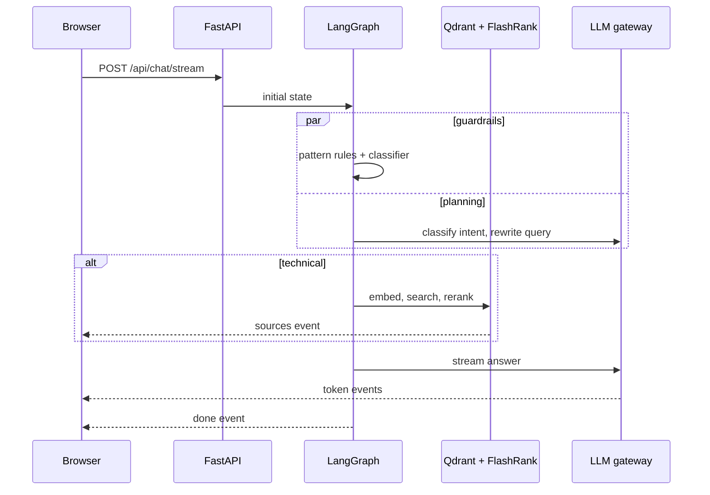

# System Overview

StratumAI is an agentic retrieval-augmented assistant for engineering teams. It separates questions that need the knowledge base from conversational turns, grounds technical answers in reranked passages, and streams every answer to the browser as it is generated.

## Components

| Layer | Technology | Responsibility |
| --- | --- | --- |
| Web app | Next.js, React, Tailwind CSS | Chat UI, streaming renderer, local conversation history |
| API | FastAPI, Server-Sent Events | Validation, rate limiting, CORS, streaming transport |
| Agent | LangGraph | Routing between analyze, retrieve, respond and refuse |
| Guardrails | Pattern rules, Prompt Guard 2 | Prompt injection and input size protection |
| Retrieval | Gemini embeddings, Qdrant, FlashRank | Semantic search and cross-encoder reranking |
| Gateway | In-house router over HTTP | Provider fallback, cooldowns, caching |
| Observability | Logfire (optional) | Request spans, provider fallbacks, time to first token |

## Request flow

## Project map

- `app/agents`: graph definition, node implementations and prompts
- `app/api`: HTTP routes, SSE encoding, schemas, rate limiter
- `app/gateway`: provider adapters and the fallback router
- `app/guardrails`: input policies and canned policy responses
- `app/services/retrieval`: embeddings, vector search and reranking
- `app/ingestion`: offline document parsing, chunking and indexing
