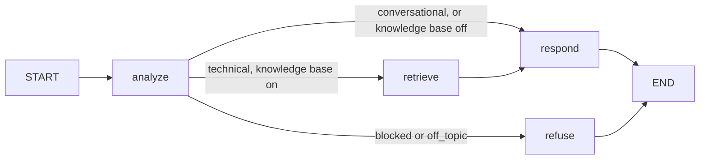

# Agent Nodes

The agent is a LangGraph `StateGraph` with four nodes. Nodes publish progress through LangGraph's custom stream, which the API forwards to the browser as SSE events.

## analyze

Runs two tasks concurrently with `asyncio.gather`:

- **Guardrails** check the raw input (see `08_GUARDRAILS.md`).
- **Planner** asks the gateway's fast model for JSON: `{"intent": "technical" | "conversational" | "off_topic", "query": "..."}`. The query is a standalone rewrite, so follow-ups such as "how do I scale it?" retrieve the right passages. If the planner fails or exceeds `PLANNER_BUDGET_SECONDS`, the node defaults to `technical` with the original question.

## retrieve

Embeds the search query, pulls `RETRIEVAL_CANDIDATES` passages from Qdrant, reranks them with FlashRank and keeps `RETRIEVAL_TOP_K` within the `MAX_CONTEXT_CHARS` budget. Passages are numbered for citation and a `sources` event is emitted before generation starts. Retrieval failures degrade gracefully to an answer without context.

## respond

Builds the prompt from one of three system prompts (grounded, general, conversational), the recent history and, for grounded answers, the numbered context. Tokens are streamed from the gateway and emitted as `token` events; a `model` event reports which provider answered and how many fallbacks were needed.

## refuse

Streams the policy response for blocked or off-topic requests without calling a model.

## State

| Key | Set by | Purpose |
| --- | --- | --- |
| `question`, `history`, `preferred_provider`, `use_knowledge_base` | API | Request input |
| `intent`, `search_query`, `refusal` | analyze | Routing decision |
| `sources`, `context` | retrieve | Grounding material |
| `answer`, `provider`, `model`, `cached`, `fallbacks` | respond / refuse | Result |
| `plan` | all nodes | Readable trace returned in the `done` event |
